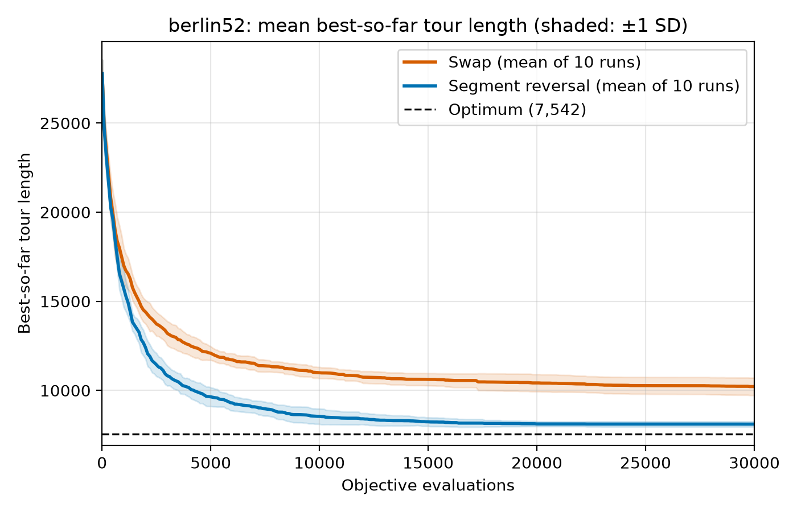
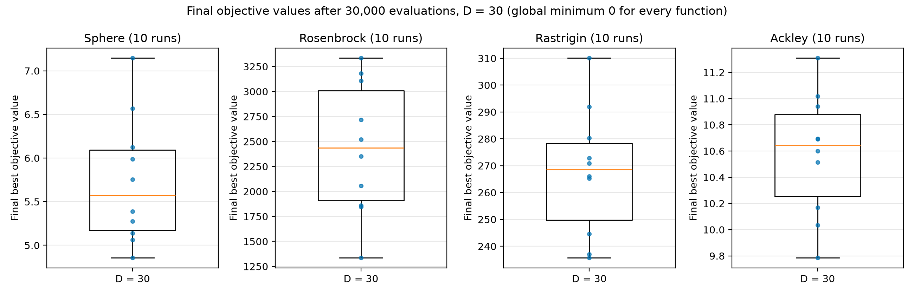
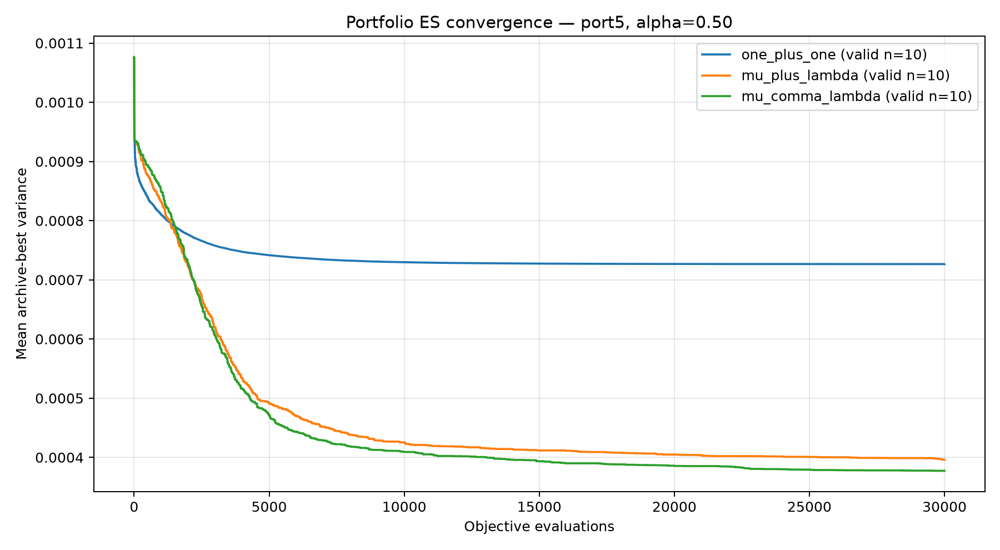

# ACIT4610 Final Group Project: Bees Algorithm and Evolution Strategies

This repository contains the two problems of the ACIT4610 final group project.
**Problem 1** applies the **Bees Algorithm (BA)** to the Travelling Salesman
Problem (Part A) and to four continuous benchmark functions (Part B). **Problem 2**
applies three **Evolution Strategies (ES)**, (1+1)-ES, (mu+lambda)-ES and
(mu,lambda)-ES, to minimise portfolio variance under long-only, budget and
minimum-return constraints. Group number: **Group-8**. Group members: **Zhongye
Xue, Syed Mohammad Abdur-Rahman Tirmizey, Jakob Andreas Amtedal, Khoa Anh Huynh**.

All **650 required runs** were completed with exactly 30,000 objective evaluations
each: **200 BA runs**, all passing independent validation, and **450 ES runs** with
450 valid final allocations. Each problem saves raw records with provenance,
checks them independently, and generates its summary tables and figures from the
saved records.

| Problem | Algorithm | Parts / variants | Runs | Folder |
| --- | --- | --- | ---: | --- |
| 1 | Bees Algorithm | Part A: TSP (swap, segment reversal); Part B: continuous functions | 200 | [bees_optimization](bees_optimization/README.md) |
| 2 | Evolution Strategies | (1+1)-ES, (mu+lambda)-ES, (mu,lambda)-ES | 450 | [portfolio_optimization](portfolio_optimization/README.md) |

Both problems follow the same workflow:

```text
Read and validate original benchmark data
    -> implement and validate objective functions
    -> implement optimization algorithms
    -> execute seeds 0-9 with exactly 30,000 objective evaluations
    -> save solutions and best-so-far histories
    -> generate statistical summaries and figures
    -> independently validate experimental results
```

The sections below summarise each problem; each problem folder has its own
README with the full design, worked examples, result tables and figures.

---

## Problem 1: Bees Algorithm

The BA minimises the rounded tour length of six TSPLIB instances (**Part A**) and
the value of Sphere, Rosenbrock, Rastrigin and Ackley at D = 10 and 30
(**Part B**). Both parts share one search loop (`bees/search.py`); representation,
initialization, objective and neighbourhood differ.

### 1.1 How the next population is created

Example configuration: **berlin52**, **segment reversal**, seed **1**, Setting B
with **10 scouts, 3 selected sites, 1 elite site, 10 elite recruits and 5 recruits
per other selected site**: 27 evaluations per complete iteration, so
10 initial + 1,110 x 27 = 29,980, then 20 final recruits.

```text
Initialize and evaluate 10 scouts
    -> rank by objective; select 3 sites, the best 1 is elite
    -> recruit 10 neighbours at the elite site and 5 at each other selected site,
       always from the ORIGINAL site
    -> each site keeps the best of itself and its recruits
    -> replace the 7 unselected sites with fresh random scouts
    -> update the global best-so-far after every evaluation
    -> repeat until exactly 30,000 evaluations
```

### 1.2 Algorithm design

| Block | Part A: TSP | Part B: continuous functions |
| --- | --- | --- |
| Encoding | Permutation of cities, city 1 fixed first | Real vector, D = 10 or 30 |
| Initialization | Uniform random permutations | Uniform within bounds |
| Neighbourhood | One random swap or one segment reversal | Uniform change of +/-10% of the domain width per coordinate, fixed radius |
| Repair / validity | Every city exactly once | Clip to bounds |
| Evaluation | Rounded EUC_2D tour length with the return edge | Unshifted function value; minimum 0 |
| Replacement | Site keeps the best of itself and its recruits; fresh scouts elsewhere | Same |
| Termination | Exactly 30,000 evaluations, incomplete final iteration allowed | Same |

TSP distances use the TSPLIB rule `d(i,j) = floor(sqrt((xi-xj)^2 + (yi-yj)^2) + 0.5)`,
rounded per edge before summation. Python's `round()` is not used because its
ties-to-even behaviour differs. Published optimal tours and known minimizers are
used for evaluation and tests only, never inside the search. See
[Problem 1, section 2](bees_optimization/README.md#2-algorithm-design) for the
function definitions and the distance and neighbourhood examples.

### 1.3 Instances and experiment parameters

| Instance | Cities | Distance type | Optimal tour length |
| --- | ---: | --- | ---: |
| eil51 | 51 | EUC_2D | 426 |
| berlin52 | 52 | EUC_2D | 7,542 |
| st70 | 70 | EUC_2D | 675 |
| eil76 | 76 | EUC_2D | 538 |
| kroA100 | 100 | EUC_2D | 21,282 |
| ch150 | 150 | EUC_2D | 6,528 |

| Function | Bounds per coordinate | Minimizer | Dimensions |
| --- | --- | --- | --- |
| Sphere | [-5.12, 5.12] | All zeros | 10, 30 |
| Rosenbrock | [-5, 10] | All ones | 10, 30 |
| Rastrigin | [-5.12, 5.12] | All zeros | 10, 30 |
| Ackley | [-32.768, 32.768] | All zeros | 10, 30 |

| Parameter | Setting B (experiments) | Solver default |
| --- | ---: | ---: |
| `n_scouts` / `n_selected` / `n_elite` | 10 / 3 / 1 | 30 / 10 / 3 |
| `n_elite_recruits` / `n_other_recruits` | 10 / 5 | 10 / 5 |
| `max_evaluations` | 30,000 | 30,000 |

Part A: 6 instances x 2 neighbourhoods x seeds 0-9 = **120 runs**. Part B: 4
functions x 2 dimensions x seeds 0-9 = **80 runs**. Both parts use the same
Setting B, loaded from [tsp.json](bees_optimization/configs/tsp.json) and
[continuous.json](bees_optimization/configs/continuous.json). It was selected
through pilot comparisons on seeds 100-104, separate from the reported seeds,
against Setting A (30/10/3/10/5) and Setting C (6/2/1/5/3). **The selection
remains provisional until the group confirms the pilot evidence.** The six
TSPLIB files are bundled unchanged apart from gzip decompression; see
[TSPLIB sources](bees_optimization/data/README.md).

### 1.4 Results and evaluation

**Part A: 120 runs; Part B: 80 runs; all 200 validated on 22 November 2026.**
Each value summarises 10 runs; lower is better. Runtime is the search call only.

#### Part A: TSP

Mean gap to the published optimum, `gap (%) = 100 * (tour_length - optimum) / optimum`:

| Instance | Swap mean gap (%) | Segment reversal mean gap (%) |
| --- | ---: | ---: |
| eil51 | 34.41 | 5.54 |
| berlin52 | 35.46 | 7.50 |
| st70 | 63.02 | 8.07 |
| eil76 | 47.21 | 11.13 |
| kroA100 | 108.79 | 22.98 |
| ch150 | 153.47 | 52.32 |



- Segment reversal produced a shorter final tour than swap in all **60 of 60**
  paired instance-seed comparisons. The best berlin52 tour (segment reversal,
  seed 1) has length 7,833, a gap of 3.86%.
- Gaps grow with instance size under the fixed budget, up to 52.32% on ch150 with
  segment reversal.
- Two preliminary eil51 trials (8 November 2026, seed 42, original default
  settings, initial best 1,352) gave 622 (swap, 46.01%) and 468 (reversal, 9.86%).
  They are separate from the Setting B study.

#### Part B: Continuous functions

Mean final objective value (the minimum of every function is 0):

| Function | D = 10 | D = 30 |
| --- | ---: | ---: |
| Sphere | 0.4368 | 5.731 |
| Rosenbrock | 89.66 | 2431 |
| Rastrigin | 39.13 | 267.5 |
| Ackley | 6.216 | 10.58 |



- Every case improves strongly on its initial scouts, but final values become
  much worse from D = 10 to D = 30, and the fixed neighbourhood radius limits fine
  local search near a minimum. No case reaches the global minimum.

Best, mean, standard deviation, initial objective and runtime for every case, and
the ch150, route and Rastrigin figures, are in
[Problem 1, section 4](bees_optimization/README.md#4-results-and-evaluation).
These results describe the implemented BA under Setting B and a fixed
30,000-evaluation budget; they do not establish convergence to the global optimum.

### 1.5 Reproduce Problem 1

After [installation](#installation-and-project-structure), from the repository root:

```bash
python -m unittest discover -s bees_optimization/tests -v   # 50 tests

# Part A: one run (berlin52, segment reversal, seed 1 -> length 7833)
python -m bees_optimization.bees.experiments tsp --instances berlin52 --neighborhoods segment_reversal --seeds 1
# Part B: one run
python -m bees_optimization.bees.experiments continuous --functions sphere --dimensions 10 --seeds 0

# Rebuild tables and figures from saved records, then validate all 200 records
python -m bees_optimization.bees.output
python -m bees_optimization.bees.validate_results

# All 200 runs (overwrites bees_optimization/results/raw/)
python -m bees_optimization.bees.experiments all
```

Validation includes **50 passing tests** (22 November 2026) and independent
validation of all 200 records. Subset runs are written to
`bees_optimization/results/scratch/`. **Warning:** `experiments all` can overwrite
the committed raw records; use a separate working copy to rerun the full study.

---

## Problem 2: Portfolio Optimization via Evolution Strategies

Three ES variants search for long-only weights that minimise **portfolio
variance** `w^T Sigma w` subject to `w_i >= 0`, `sum(w) = 1` and
`r^T w >= R_min`. All three share data loading, covariance construction, repair,
feasibility checks and the evaluation counter, and return the best feasible
allocation in a separate archive.

### 2.1 How the next allocation is created

Example configuration: `port1_alpha050`, **31 assets**, **R_min =
0.007184532258065**, seed **0**. The initial step size is `0.1 / sqrt(31) = 0.01796`.

```text
Shared:       z -> repair z into feasible weights w -> evaluate w^T Sigma w
              -> update the archive if w is feasible and better

(1+1)-ES:     child = repair(parent + sigma * N(0, I))
              keep the child only if its variance is strictly lower
              sigma *= exp(1/3) after success, exp(-1/12) otherwise

(mu+lambda)-ES and (mu,lambda)-ES, mu = 10, lambda = 70:
              two different random parents -> mean weights, geometric-mean step sizes
              -> self-adapt step sizes -> mutate -> repair -> evaluate
              plus:  best 10 of parents + offspring (elitist)
              comma: best 10 of offspring only (archive not used for selection)
              10 initial + 428 generations x 70 + a final partial batch of 30
```

### 2.2 Algorithm design

| Block | (1+1)-ES | (mu+lambda)-ES | (mu,lambda)-ES |
| --- | --- | --- | --- |
| Population | 1 parent, 1 child per trial | 10 parents, 70 offspring | 10 parents, 70 offspring |
| Initialization | Uniform [0, 1] weights, repaired | Same for each parent | Same for each parent |
| Step size | Scalar, 1/5th success rule | Self-adaptive vector | Self-adaptive vector |
| Recombination | None | Mean of weights, geometric mean of step sizes | Same |
| Mutation | `sigma * N(0, 1)` per weight | `sigma'_i * N(0, 1)` after adaptation | Same |
| Repair | Simplex projection, then return repair | Same | Same |
| Replacement | Strictly lower variance only | Best 10 of parents + offspring | Best 10 of offspring |
| Termination | Exactly 30,000 evaluations | Same, final partial batch archived | Same |

Step sizes start at `0.1/sqrt(n)` and are clamped to `[1e-8, 1]`; the population
variants use `tau' = 1/sqrt(2n)` and `tau = 1/sqrt(2 sqrt(n))`. A reported
portfolio is feasible if `w_i >= -1e-8`, `abs(sum(w) - 1) <= 1e-8` and
`r^T w >= R_min - 1e-8`.

**Repair example.** With mean returns 2%, 6%, 10% and `R_min = 4%`, the vector
`z = (0.7, 0.5, -0.1)` is projected to `q = (0.6, 0.4, 0.0)` with return 3.6%.
The return repair mixes in the highest-return asset with `beta = 0.0625`, giving
`w = (0.5625, 0.375, 0.0625)` and a return of exactly 4%. See
[Problem 2, section 2](portfolio_optimization/README.md#2-algorithm-design) for
the derivation and the implementation choices.

### 2.3 Instances and experiment parameters

| Dataset | Assets | Correlation records | R_min, alpha = 0.25 / 0.50 / 0.75 |
| --- | ---: | ---: | --- |
| port1 | 31 | 496 | 0.005344 / 0.007185 / 0.009025 |
| port2 | 85 | 3,655 | 0.003567 / 0.005643 / 0.007718 |
| port3 | 89 | 4,005 | 0.004048 / 0.005435 / 0.006822 |
| port4 | 98 | 4,851 | 0.004454 / 0.006034 / 0.007615 |
| port5 | 225 | 25,425 | -0.000137 / 0.001232 / 0.002602 |

`R_min(alpha) = (1-alpha)*R_eq + alpha*r_max`, with `R_eq` the equal-allocation
return and `r_max` the highest asset return, gives **15 cases** (`port1_alpha025`
to `port5_alpha075`). 15 cases x 3 variants x seeds 0-9 = **450 runs**, all with
the same repair, seeds and budget, as recorded in
[experiments.json](portfolio_optimization/configs/experiments.json). The five
OR-Library files are bundled unchanged; see
[OR-Library sources](portfolio_optimization/data/README.md). The metadata records
source-file, configuration and dataset hashes, and `--resume` refuses to continue
when any of them has changed.

### 2.4 Results and evaluation

**(1+1)-ES, (mu+lambda)-ES and (mu,lambda)-ES: 150 runs each, 450 valid, zero
failures.** Mean final archive-best variance at alpha = 0.50 over 10 runs (10/10
valid in every row); compare only within the same case:

| Case | Assets | (1+1)-ES | (mu+lambda)-ES | (mu,lambda)-ES |
| --- | ---: | ---: | ---: | ---: |
| port1_alpha050 | 31 | 1.524e-03 | 1.166e-03 | 1.166e-03 |
| port2_alpha050 | 85 | 3.714e-04 | 2.626e-04 | 2.678e-04 |
| port3_alpha050 | 89 | 4.692e-04 | 3.542e-04 | 3.492e-04 |
| port4_alpha050 | 98 | 7.247e-04 | 4.112e-04 | 4.305e-04 |
| port5_alpha050 | 225 | 7.266e-04 | 3.961e-04 | 3.773e-04 |



- (mu+lambda)-ES reached a lower final variance than (1+1)-ES in all **150 of
  150** paired case-seed comparisons. Plus and comma are close: comma was lower
  in 84 of 150 pairs, within the run-to-run variation.
- The 1/5th rule shrinks the (1+1)-ES step size to its 1e-8 bound, leaving broad
  portfolios (on average 19.5 of 31 assets held on port1, 111 of 225 on port5)
  where the population variants find sparse ones (about 4 and 9-10 assets).
- Comma selection worsened the current population best in 29,038 of 64,200
  generations; plus selection never did. The archive best never worsens.

All 15 cases with best, mean, standard deviation, valid-run rate and runtime, and
the remaining observations, are in
[Problem 2, section 4](portfolio_optimization/README.md#4-results-and-evaluation).
Conclusions are limited to relative performance among the three tested variants;
these historical input statistics do not establish future investment performance.

### 2.5 Reproduce Problem 2

After [installation](#installation-and-project-structure), from the repository root:

```bash
python -m unittest discover -s portfolio_optimization/tests   # 124 tests

# One test case (written to portfolio_optimization/results/scratch/)
python -m portfolio_optimization.portfolio pilot --dataset port1 --alpha 0.50 --variant mu_plus_lambda --seed 0 --budget 30000

# Validate the saved records and rebuild the summary table and convergence plot
python -m portfolio_optimization.portfolio summarize --runs portfolio_optimization/results/raw/portfolio_runs.jsonl

# All 450 runs: 15 cases x 3 variants x seeds 0-9
python -m portfolio_optimization.portfolio full --confirm-450
```

The test suite contains **124 tests**; see the
[test documentation](portfolio_optimization/tests/README.md). `pilot` defaults to
a budget of 300, so `--budget 30000` reproduces a recorded run; variants are
`one_plus_one`, `mu_plus_lambda` and `mu_comma_lambda`. `full` never overwrites
existing records and continues an interrupted run with `--resume`.

---

## Installation and project structure

Use Python **3.11 or newer** with the pinned NumPy and Matplotlib versions in
[requirements.txt](requirements.txt). The BA algorithms, runner and data check use
the standard library; Matplotlib is needed for figures and the complete test
suites, and NumPy for Problem 2. Until these changes are merged into `main`, check
out the branch that contains them.

```bash
git clone https://github.com/e-KOP/acit4610-final-group-project.git
cd acit4610-final-group-project
python -m venv .venv
source .venv/bin/activate            # Windows PowerShell: .venv\Scripts\Activate.ps1
python -m pip install -r requirements.txt

# Check the eleven original benchmark files against their SHA-256 checksums
python scripts/verify_data.py
```

```text
.
├── README.md
├── requirements.txt
├── bees_optimization/        # Problem 1: Bees Algorithm
│   ├── bees/                 # BA solver, experiments, output, validation
│   ├── configs/              # TSP and continuous experiment settings
│   ├── data/tsplib/          # Six original TSP benchmark datasets
│   ├── tests/                # 50 algorithm and experiment tests
│   └── results/              # raw/ (200 records), tables/, figures/ (5)
├── portfolio_optimization/   # Problem 2: Evolution Strategies
│   ├── portfolio/            # Data, repair, feasibility, three ES variants, runner, CLI
│   ├── configs/              # Portfolio experiment settings
│   ├── data/or_library/      # Five original portfolio datasets
│   ├── tests/                # 124 data, operator, solver and pipeline tests
│   └── results/              # raw/ (450 records), tables/, figures/ (1)
├── scripts/verify_data.py    # Original dataset integrity verification
├── docs/                     # Requirements checklist, development log, AI-use record
└── report/                   # Group-authored submission report
```

### Remaining work and AI use

- Confirm the BA parameter-selection pilot evidence (Setting B).
- Review the combined implementation and documentation as a group.
- Write and check the combined 3,000-7,500-word report and complete the Inspera
  submission by 30 November 2026 at 12:00.

The report must be written by the group in accordance with the course's AI-use
restrictions; AI-produced code must be marked and its use disclosed. The
[AI-use record](docs/ai_usage.md) documents assistance during development,
[docs/development.md](docs/development.md) tracks implementation progress and
the [submission checklist](docs/requirements.md) summarises the assignment
requirements.

### Related repositories

- [Assignment 1: Job Shop Scheduling Problem](https://github.com/e-KOP/acit4610-assignment-1-jssp)
- [Assignment 2: Capacitated Facility Location Problem](https://github.com/e-KOP/acit4610-assignment-2-cflp)
