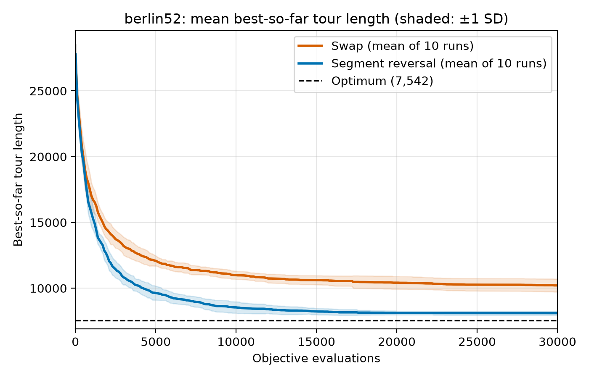
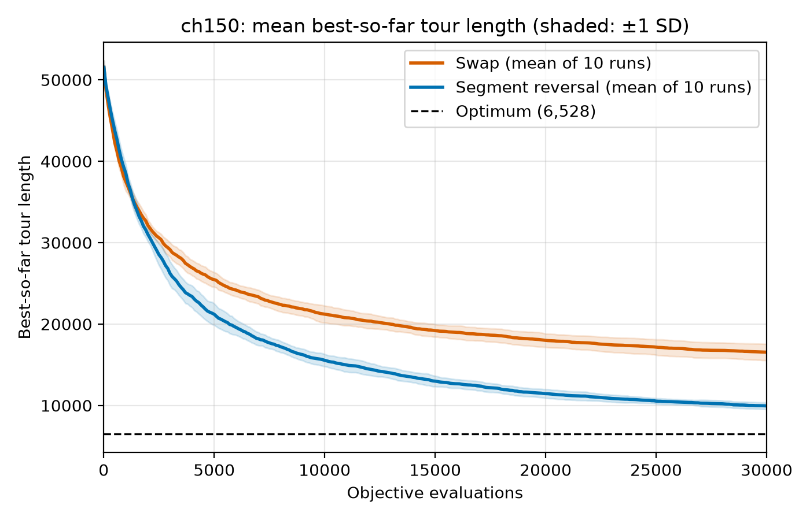
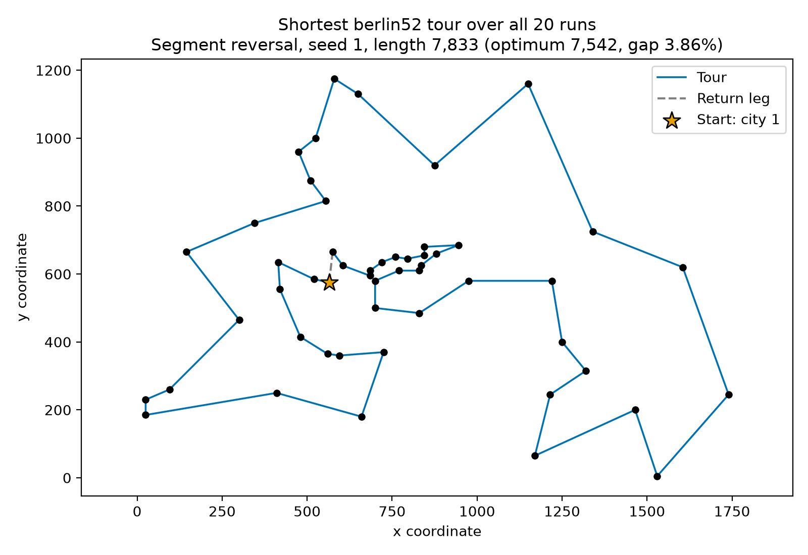
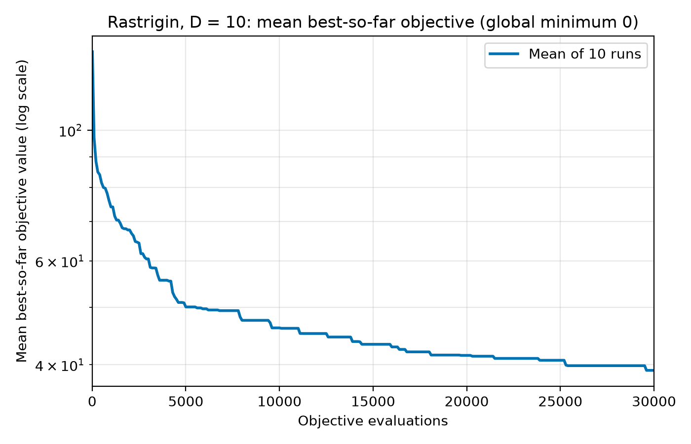
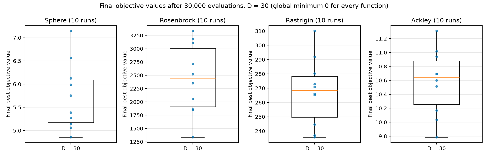

# Problem 1: Bees Algorithm for TSP and Continuous Optimization

The **Bees Algorithm (BA)** is applied to two problem types with one shared
search implementation. **Part A** minimises the rounded tour length of six
TSPLIB instances with two neighbourhood operators, **swap** and **segment
reversal**. **Part B** minimises four continuous benchmark functions,
**Sphere, Rosenbrock, Rastrigin and Ackley**, at dimensions 10 and 30. Group
number: **Group-8**. See the [root README](../README.md) for group members and
Problem 2.

Representation, initialization, objective and neighbourhood differ between the
two parts; site selection, recruitment, retention, scouting and the evaluation
budget are shared. All **200 runs** were completed with exactly 30,000 objective
evaluations each, and all 200 records passed independent validation on
22 November 2026. Section 4 presents the results.

## 1. How the next population is created

Example configuration: **berlin52**, **segment reversal**, seed **1**, Setting B
with **10 scouts, 3 selected sites, 1 elite site, 10 elite recruits and 5 recruits
per other selected site**. One complete iteration evaluates
`1 x 10 + 2 x 5 = 20` recruits and `10 - 3 = 7` fresh scouts, **27 evaluations**.
With 30,000 evaluations: 10 initial scouts + 1,110 complete iterations x 27 =
29,980, followed by 20 more recruits before the budget is used up.

```text
Initialize and evaluate 10 scouts (10 evaluations)
    -> rank solutions by objective value (lower is better)
    -> select the best 3 sites; the best 1 is the elite site
    -> elite site: 10 recruits; each other selected site: 5 recruits
       every recruit is a neighbour of the ORIGINAL site, not of an earlier recruit
    -> each site keeps the best of itself and its recruits (strict improvement only)
    -> replace the 7 unselected sites with fresh random scouts
    -> update the global best-so-far record after every evaluation
    -> repeat until exactly 30,000 evaluations
    -> return the global best
```

The global best-so-far record is separate from the population, so the best
solution encountered is never lost when sites are replaced. The budget is
completed even when the best objective stops improving.

## 2. Algorithm design

| Block | TSP | Continuous functions |
| --- | --- | --- |
| Encoding | Permutation of cities, with city 1 fixed first | Real-valued vector of dimension 10 or 30 |
| Initialization | Uniform random permutations of cities 2..n | Independent uniform coordinates within bounds |
| Site selection | Best 3 of 10 by objective; best 1 is elite | Same |
| Neighbourhood | Random swap or segment reversal | Independent uniform perturbation of every coordinate |
| Neighbourhood size | One swap or one segment reversal | +/-10% of each coordinate's domain width, fixed (no decay) |
| Repair / validity | Every city appears exactly once; city 1 never moves | Coordinates clipped to permitted bounds |
| Evaluation | Total rounded tour length, including the return edge | Unshifted benchmark function value |
| Replacement | Site keeps the best of itself and its recruits; unselected sites become fresh scouts | Same |
| Termination | Exactly 30,000 objective evaluations | Same evaluation counting rule |

The TSP implementation supports `swap` and `segment_reversal`, with `reverse`
retained as a compatible alias.

### TSP distance calculation

For every pair of cities, use the TSPLIB EUC_2D convention:

```text
distance(i,j) = floor(sqrt((xi-xj)^2 + (yi-yj)^2) + 0.5)
```

Distances are rounded individually before summation. Python's built-in `round()`
must not replace this calculation because it uses ties-to-even rounding.

Example with berlin52: city 1 is at (565, 575) and city 2 at (25, 185).

```text
(565 - 25)^2 + (575 - 185)^2 = 291,600 + 152,100 = 443,700
sqrt(443,700) = 666.108  ->  floor(666.108 + 0.5) = 666
```

Published optimal tour lengths are used for evaluating results, never for
initializing or guiding the search.

### Neighbourhood example

Starting from a tour with city 1 fixed, `1 2 3 4 5 6`:

```text
swap positions 2 and 5:              1 5 3 4 2 6   (four edges change)
reverse the segment positions 2..5:  1 5 4 3 2 6   (two edges change)
```

Segment reversal is the 2-opt move: it replaces two edges and keeps the rest of
the tour intact, which explains its much lower gaps in section 4. These are
illustrative tours, not benchmark results.

### Continuous benchmark functions

| Function | Definition | Bounds per coordinate | Global minimizer |
| --- | --- | --- | --- |
| Sphere | `sum(x_i^2)` | [-5.12, 5.12] | All zeros |
| Rosenbrock | `sum(100*(x_(i+1)-x_i^2)^2 + (1-x_i)^2)` | [-5, 10] | All ones |
| Rastrigin | `10*D + sum(x_i^2 - 10*cos(2*pi*x_i))` | [-5.12, 5.12] | All zeros |
| Ackley | `-20*exp(-0.2*sqrt(sum(x_i^2)/D)) - exp(sum(cos(2*pi*x_i))/D) + 20 + exp(1)` | [-32.768, 32.768] | All zeros |

All four functions have a global minimum of zero. The implementations are checked
against their known minimizers and additional numerical test cases. Known
minimizing vectors are never inserted into the search. See
[benchmark data and sources](data/README.md).

## 3. Instances and experiment parameters

| Instance | Cities | Distance type | Optimal tour length |
| --- | ---: | --- | ---: |
| eil51 | 51 | EUC_2D | 426 |
| berlin52 | 52 | EUC_2D | 7,542 |
| st70 | 70 | EUC_2D | 675 |
| eil76 | 76 | EUC_2D | 538 |
| kroA100 | 100 | EUC_2D | 21,282 |
| ch150 | 150 | EUC_2D | 6,528 |

The original TSPLIB files are bundled in `data/tsplib`; see
[data details](data/README.md).

| Parameter | Setting B (experiments) | Solver default |
| --- | ---: | ---: |
| `n_scouts` | 10 | 30 |
| `n_selected` | 3 | 10 |
| `n_elite` | 1 | 3 |
| `n_elite_recruits` | 10 | 10 |
| `n_other_recruits` | 5 | 5 |
| `max_evaluations` | 30,000 | 30,000 |

The experiment runner loads Setting B from the JSON configuration files and
passes it explicitly to the solver; the original Python function defaults
(`30/10/3/10/5`) were **not** used in the committed 200 experiments. The group
compared Settings A (30/10/3/10/5), B (10/3/1/10/5) and C (6/2/1/5/3) on
pilot seeds **100–104**, distinct from official seeds 0–9. Setting A was worse
on TSP; B and C performed similarly, with C achieving the lower six-instance
TSP mean gap but B winning the three smallest reversal instances. B also had
the lowest mean continuous error in six of eight function/dimension cases.
The group fixed **B** for both parts as a practical compromise, **not** as an
assertion of global or statistical superiority. See the [pilot evidence and
reproduction instructions](pilot/README.md).

- [TSP configuration](configs/tsp.json): 6 instances x 2 neighbourhoods x 10 seeds = **120 runs**.
- [Continuous configuration](configs/continuous.json): 4 functions x 2 dimensions x 10 seeds = **80 runs**.

Both experiments use seeds **0-9**, giving **200 runs** and **6,000,000 objective
evaluations**. Each run counts initialization, recruited neighbours, rejected
candidates and fresh scouts. Runtime is the wall-clock time of the search call
only; data loading is excluded and runs are sequential. The metadata file records
the command, source revision, Python version, platform, configurations and
TSPLIB checksums.

## 4. Results and evaluation

**TSP: 120 runs; continuous: 80 runs; all 200 executed and committed on
20 November 2026 and validated on 22 November 2026.** Each row summarises 10
independent runs with 30,000 evaluations each. Runtime values describe the local
execution recorded in the metadata and may differ on another machine.

- **Quality:** final best tour length or objective value; lower is better. Report
  best, mean and sample standard deviation over 10 runs.
- **Gap:** `gap (%) = 100 * (tour_length - optimum) / optimum`.
- **Initial best:** best of the 10 initial scouts, to show the improvement.
- **Efficiency:** mean runtime of the search call.

### Part A: TSP results

| Instance | Neighbourhood | Best | Mean | SD | Mean gap (%) | Mean initial best | Mean runtime (s) |
| --- | --- | ---: | ---: | ---: | ---: | ---: | ---: |
| eil51 | Swap | 550 | 572.6 | 18.5 | 34.41 | 1,515.5 | 0.296 |
| eil51 | Segment reversal | 438 | 449.6 | 6.3 | 5.54 | 1,515.5 | 0.306 |
| berlin52 | Swap | 9,596 | 10,216.4 | 487.7 | 35.46 | 27,769.6 | 0.310 |
| berlin52 | Segment reversal | 7,833 | 8,107.8 | 148.5 | 7.50 | 27,769.6 | 0.334 |
| st70 | Swap | 991 | 1,100.4 | 74.2 | 63.02 | 3,411.7 | 0.408 |
| st70 | Segment reversal | 699 | 729.5 | 23.1 | 8.07 | 3,411.7 | 0.421 |
| eil76 | Swap | 721 | 792.0 | 42.7 | 47.21 | 2,334.1 | 0.409 |
| eil76 | Segment reversal | 579 | 597.9 | 13.6 | 11.13 | 2,334.1 | 0.424 |
| kroA100 | Swap | 35,397 | 44,435.1 | 3,713.5 | 108.79 | 160,839.4 | 0.607 |
| kroA100 | Segment reversal | 24,029 | 26,173.5 | 1,127.0 | 22.98 | 160,839.4 | 0.618 |
| ch150 | Swap | 15,378 | 16,546.4 | 998.9 | 153.47 | 51,539.2 | 0.836 |
| ch150 | Segment reversal | 9,319 | 9,943.2 | 411.4 | 52.32 | 51,539.2 | 0.862 |

Full-precision values are in [results/tables/tsp_summary.csv](results/tables/tsp_summary.csv).

**Convergence: berlin52 and ch150.** The horizontal axis is the number of
objective evaluations; the vertical axis is the best-so-far tour length averaged
over the 10 seeds. Histories are aligned by evaluation count, not iteration.





**Best berlin52 route** (segment reversal, seed 1, length 7,833, gap 3.86%),
including the return edge:



### Part B: Continuous optimization results

| Function | D | Best | Mean | SD | Mean initial best | Mean runtime (s) |
| --- | ---: | ---: | ---: | ---: | ---: | ---: |
| Sphere | 10 | 0.2873 | 0.4368 | 0.117 | 53.88 | 0.114 |
| Sphere | 30 | 4.856 | 5.731 | 0.7322 | 194.3 | 0.258 |
| Rosenbrock | 10 | 56.65 | 89.66 | 15.73 | 4.195e+05 | 0.174 |
| Rosenbrock | 30 | 1335 | 2431 | 662.1 | 2.009e+06 | 0.447 |
| Rastrigin | 10 | 31.25 | 39.13 | 5.882 | 135.8 | 0.151 |
| Rastrigin | 30 | 235.7 | 267.5 | 23.79 | 473.9 | 0.368 |
| Ackley | 10 | 5.483 | 6.216 | 0.4678 | 20.48 | 0.168 |
| Ackley | 30 | 9.785 | 10.58 | 0.4694 | 20.86 | 0.387 |

All four functions have a theoretical minimum of zero, so the values are also
the error to the optimum. Full-precision values are in
[results/tables/continuous_summary.csv](results/tables/continuous_summary.csv).





**Observations from the 200 committed runs:**

- **Segment reversal versus swap.** Segment reversal achieved a lower final tour
  length than swap in all **60 of 60** paired instance-seed comparisons.
- **Instance size.** Gaps grow with the number of cities under the fixed budget,
  from 5.54% (eil51) to 52.32% (ch150) for segment reversal.
- **Dimension.** Every function is much harder at D=30 than at D=10 with the same
  budget and a fixed 10% perturbation radius.
- **Improvement over initialization.** Every case improves strongly on the best
  initial scout, but no case reaches the global minimum.
- **Earlier trials.** The seed-42 eil51 trials with the original default BA
  settings produced 622 (swap) and 468 (reversal). They are separate from the
  Setting B experiments.

**Discussion and conclusions:** these results describe performance under the
selected configuration and evaluation budget; they do not establish convergence
to the global minimum.

## 5. Reproduce the project

Use Python **3.11 or newer**. Run every command from the **repository root**.

```bash
python -m pip install -r requirements.txt
python scripts/verify_data.py                            # check the TSPLIB and OR-Library files
python -m unittest discover -s bees_optimization/tests -v  # all 50 Problem 1 tests

# One TSP run: reproduces berlin52, segment reversal, seed 1, length 7,833
python -m bees_optimization.bees.experiments tsp --instances berlin52 --neighborhoods segment_reversal --seeds 1

# One continuous run
python -m bees_optimization.bees.experiments continuous --functions sphere --dimensions 10 --seeds 0

# Regenerate summary tables and figures from the saved raw records
python -m bees_optimization.bees.output

# Independently validate the 200 committed records
python -m bees_optimization.bees.validate_results

# Rerun all 200 experiments (overwrites results/raw/)
python -m bees_optimization.bees.experiments all
```

Validation includes **50 passing tests** (22 November 2026); see
[test documentation](tests/README.md).

- Subset runs (any of `--seeds`, `--instances`, `--neighborhoods`, `--functions`,
  `--dimensions`) are saved under `results/scratch/`, preserving the committed
  records.
- `output` regenerates tables and figures without rerunning the optimizer. It
  writes to the existing results directories.
- **Warning:** `experiments all` writes to `results/raw/` and can overwrite the
  committed raw records and metadata. Use a separate working copy to rerun the
  full study.

The commands generate `results/raw/tsp_runs.jsonl`, `results/raw/continuous_runs.jsonl`,
`results/raw/metadata.json`, the CSV and Markdown tables in `results/tables/` and
the five figures in `results/figures/`. See the [results inventory](results/README.md).

The main components are in [`bees/`](bees/README.md): `search.py` (shared BA
loop), `tsplib.py`, `initialization.py`, `neighborhoods.py` and `algorithm.py`
(TSP), `functions.py` and `continuous.py` (continuous functions),
`experiments.py`, `output.py` and `validate_results.py` (runner, summaries and
independent checks).

The continuous solver returns this result contract:

```python
from bees_optimization.bees.continuous import continuous_bees

result = continuous_bees("rastrigin", dimension=30, seed=42)
print(result["best_value"], result["evaluations"])
```

- `best_vector`: best continuous solution.
- `best_value`: best objective value.
- `initial_best`: best initial scout objective.
- `evaluations`: number of evaluated candidates.
- `history`: best-so-far objective history. It starts after the initial
  population is evaluated and records every later evaluation; the experiment
  runner compresses it before saving.

### Independent validation

`bees/validate_results.py` checks:

- All 120 TSP and 80 continuous records, complete configuration and seed coverage,
  and no duplicate records.
- Exact evaluation budgets and BA settings.
- Valid TSP permutations and independently recalculated tour lengths.
- Continuous solution bounds and independently recalculated objectives.
- Consistent initial and final objectives, and ordered, non-increasing
  best-so-far histories.
- Full-precision statistical summary tables.
- Configuration provenance and original TSPLIB dataset checksums.

All 200 committed records passed these checks on 22 November 2026.

| Test file | Coverage |
| --- | --- |
| `test_algorithm.py` | Original TSP Bees Algorithm behaviour |
| `test_tsp_data.py` | TSPLIB parsing, distance matrices, neighbourhoods and regression tests |
| `test_search.py` | Shared BA search, recruitment, budgets and parameter boundaries |
| `test_continuous.py` | Continuous objectives, dimensions, bounds and deterministic behaviour |
| `test_results.py` | Independent result calculations, integrity checks, invalid-record detection and full experiment validation |
| `test_experiment_pipeline.py` | Configuration, history compression, small batches, convergence alignment and output regeneration |

The validation tests include deliberately invalid records to confirm that
incorrect tours, objectives, histories, settings and experiment coverage are
rejected. The pipeline tests regenerate all required figures and tables in
temporary directories without modifying the committed results.

The full experiments and independent validation establish reproducibility and
internal consistency of the reported results, not a guarantee of finding the
global optimum.
