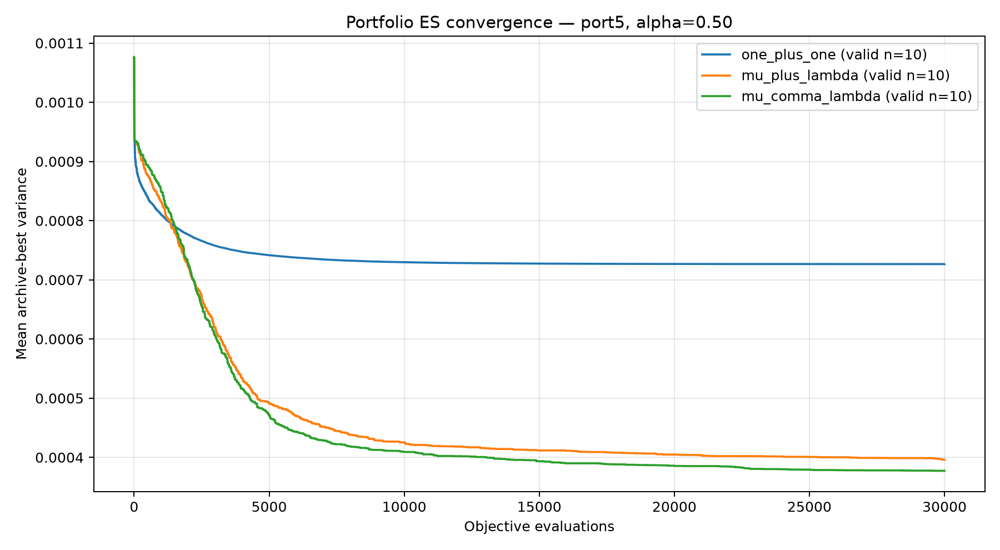

# Problem 2: Portfolio Optimization via Evolution Strategies

Three Evolution Strategies, **(1+1)-ES**, **(mu+lambda)-ES** and **(mu,lambda)-ES**,
search for long-only investment weights that minimise **portfolio variance**
while using the whole budget and meeting a minimum expected return. Group number:
**Group-8**. See the [root README](../README.md) for group members and Problem 1.

All three variants share data loading, covariance construction, repair,
feasibility checks and the evaluation counter. The experiment runner checks every
record independently, saves allocations and best-so-far histories, and builds the
summary table and convergence plot. All **450 runs** were completed with
**450 valid final allocations**. Section 4 presents the results.

## 1. How the next allocation is created

Example configuration: `port1_alpha050`, **31 assets**, target return
**R_min = 0.007184532258065**, seed **0**, and a budget of **30,000 objective
evaluations**, including initialization. The initial step size is
`0.1 / sqrt(31) = 0.01796`; the population variants use
`tau_prime = 1 / sqrt(62) = 0.1270` and `tau = 1 / sqrt(2 * sqrt(31)) = 0.2997`.

All three variants share this preparation and candidate pipeline:

```text
Read port1: 31 mean returns, 31 standard deviations, 496 correlation records
    -> construct Sigma_ij = s_i * s_j * C_ij
    -> calculate R_eq, r_max and R_min(alpha)

Draw or mutate a real vector z -> repair z into feasible weights w
    -> evaluate variance w^T Sigma w (one evaluation)
    -> update the archive if w is feasible and has lower variance
```

### (1+1)-ES

```text
Start with one repaired parent and a scalar step size sigma
    -> child = repair(parent + sigma * N(0, I))
    -> replace the parent only if the child's variance is strictly lower
    -> multiply sigma by exp(1/3) after a success, exp(-1/12) otherwise
    -> clamp sigma to [1e-8, 1.0]
    -> repeat until 30,000 evaluations: 1 initial + 29,999 trials
    -> return the archive best
```

One success in five trials leaves sigma unchanged:
`exp(1/3) * exp(-1/12)^4 = 1`.

### (mu+lambda)-ES and (mu,lambda)-ES

```text
Start with mu = 10 repaired parents, each with step-size vector 0.1/sqrt(n)
    -> for each of lambda = 70 children:
         choose two different parents uniformly at random
         average their weights; take the geometric mean of their step sizes
         adapt step sizes: sigma' = sigma * exp(tau_prime * Z0 + tau * Zi)
         mutate weights with fresh normal draws, repair, evaluate
    -> plus:  keep the best 10 of parents + offspring
       comma: keep the best 10 of the offspring only
    -> repeat: 10 initial + 428 generations x 70 + a final partial batch of 30
    -> return the archive best
```

Plus selection is **elitist**: the population best never worsens. Comma selection
discards every parent after one generation, so the population best can worsen;
the separate archive cannot. In comma selection the archive is used for
reporting only and never enters parent selection.

## 2. Algorithm design

| Block | Design |
| --- | --- |
| Encoding | A real vector `w` of length n; `w_i` is the budget fraction in asset `i`. port1 has 31 weights, port5 225. |
| Initialization | Independent uniform [0, 1] values, then repair. Population variants create 10 parents this way. |
| Step sizes | (1+1)-ES: one scalar, initially `0.1/sqrt(n)`. Population ES: one step size per asset, initially `0.1/sqrt(n)`, stored with each individual. All updated step sizes are clamped to `[1e-8, 1.0]`. |
| Parent choice | (1+1)-ES: the current parent. Population ES: two **different** parents, uniformly at random. |
| Recombination | Population ES only: arithmetic mean of weights; geometric mean of step sizes. |
| Mutation | (1+1)-ES: `sigma * N(0, 1)` added to every weight. Population ES: adapt step sizes first (one shared `Z0`, independent `Zi`), then add `sigma'_i * N(0, 1)` with fresh draws. |
| Repair | Simplex projection, then return repair toward the highest-return asset. Details below. |
| Evaluation | One variance calculation `w^T Sigma w` of an already repaired candidate. |
| Replacement | (1+1)-ES: strict improvement only. Plus: best 10 of parents and offspring. Comma: best 10 of offspring. |
| Archive | Best feasible allocation seen so far, including initialization. It is returned at the end. |
| Termination | Stop at exactly 30,000 evaluations. A final partial batch of 30 offspring is evaluated and archived; no survivor selection follows it. |

### Objective and feasibility

For mean returns `r`, standard deviations `s` and correlations `C`, use decimal
returns throughout.

```text
Minimise   V(w) = w^T Sigma w,          Sigma_ij = s_i * s_j * C_ij

Long-only:           w_i >= 0
Whole budget:        sum_i w_i = 1
Minimum return:      R(w) = r^T w >= R_min
```

Every reported solution must satisfy `w_i >= -1e-8`, `abs(sum(w) - 1) <= 1e-8`
and `r^T w >= R_min - 1e-8`. `feasibility.py` checks this independently of the
search code; the archive accepts only allocations that pass this check.

### Repair

Every candidate is repaired before it is evaluated:

```text
Step 1  project z onto the simplex: q_i = max(z_i - theta, 0), theta chosen so sum(q) = 1
Step 2  if r^T q >= R_min: w = q
        otherwise, with j the asset of maximum return:
            beta = (R_min - r^T q) / (r_max - r^T q)
            w = (1 - beta) * q + beta * e_j
```

Projection gives non-negative weights that sum to one. Because the return is
linear in `w`, the convex combination in step 2 raises the return exactly to
`R_min` and keeps the weights feasible. The implementation divides the projected
weights by their sum once more to remove floating-point rounding.

### Repair example: three assets

The assignment example uses mean returns **2%, 6%, 10%**, standard deviations
**10%, 20%, 30%**, zero correlations and **R_min = 4%**.

| Candidate | Weights | Expected return | Variance |
| --- | --- | ---: | ---: |
| A | 0.50, 0.30, 0.20 | 0.048 | 0.0097 |
| B | 0.60, 0.30, 0.10 | 0.040 | 0.0081 |

Both are feasible and B has lower variance, so (1+1)-ES would replace A with B.

A mutated vector `z = (0.7, 0.5, -0.1)` is repaired as follows:

```text
Step 1  keep the two largest values: theta = (0.7 + 0.5 - 1) / 2 = 0.1
        q = (0.6, 0.4, 0.0)            r^T q = 0.036 < 0.04
Step 2  j = asset 3 (r_max = 0.10)
        beta = (0.04 - 0.036) / (0.10 - 0.036) = 0.0625
        w = 0.9375 * (0.6, 0.4, 0.0) + 0.0625 * (0, 0, 1) = (0.5625, 0.375, 0.0625)
        r^T w = 0.04,  V(w) = 0.009140625
```

This is a worked repair example, not a benchmark result.

### Implementation choices where the specification leaves room

| Topic | Choice |
| --- | --- |
| Parent choice for recombination | Two **different** parents, uniformly at random (without replacement) |
| What is stored after repair | The repaired weights (they are recombined and mutated later); step sizes are stored as adapted, they are not repaired |
| Ties in survivor selection | Stable sort: on equal variance, parents are kept before offspring, earlier offspring before later |
| Ties in (1+1)-ES | A child with **equal** variance is rejected (strictly lower required) and counts as a failure for the 1/5th rule |
| Budget smaller than 10 | Population initialization stops at the budget and the best evaluated parent is returned |
| Final partial batch | Evaluated and archived; no survivor selection follows, because the budget is used up |
| Variance in the search loop | Computed with NumPy (`w @ Sigma @ w`); repair and feasibility use the shared pure-Python functions. The runner recomputes the reported variance with `evaluation.portfolio_variance` |
| Random numbers | `numpy.random.default_rng(seed)`. With the same seed, plus and comma make identical draws until the first survivor selection (evaluations 1-80), so both start from the same population |
| Extra output | Population variants also return `population_best`: the best variance in the parent population at each generation (evaluations 10, 80, 150, ... 29,970). It shows that comma selection can lose its best parent while the archive cannot worsen |

## 3. Instances and experiment parameters

| Dataset | Assets | Correlation records |
| --- | ---: | ---: |
| port1.txt | 31 | 496 |
| port2.txt | 85 | 3,655 |
| port3.txt | 89 | 4,005 |
| port4.txt | 98 | 4,851 |
| port5.txt | 225 | 25,425 |

The original [OR-Library](https://people.brunel.ac.uk/~mastjjb/jeb/orlib/portinfo.html)
files are bundled in `data/or_library`; see [data details](data/README.md). Mean
returns, standard deviations and correlations remain unchanged.

With equal weights `u_i = 1/n`, calculate `R_eq = r^T u`, `r_max = max_i r_i` and
`R_min(alpha) = (1-alpha)*R_eq + alpha*r_max` for **alpha = 0.25, 0.50, 0.75**.
Case names run from `port1_alpha025` through `port5_alpha075`. Parse 1-based
correlation indices into Python's 0-based indices and mirror each record into
both halves of `C`. For `port1.txt` the parser reproduces the assignment
checkpoints:

| Check | Expected value |
| --- | ---: |
| Equal-allocation return | 0.003504064516129 |
| Equal-allocation variance | 0.001130937943724 |
| Minimum return at alpha=0.50 | 0.007184532258065 |

| Variant | Population | Offspring | Step-size rule | Survivors | Evaluation budget |
| --- | ---: | ---: | --- | --- | ---: |
| (1+1)-ES | 1 | 1 per trial | 1/5th success rule, scalar | Strict improvement | 30,000 |
| (mu+lambda)-ES | 10 | 70 per generation | Self-adaptive vector | Parents + offspring | 30,000 |
| (mu,lambda)-ES | 10 | 70 per generation | Self-adaptive vector | Offspring only | 30,000 |

[configs/experiments.json](configs/experiments.json) contains the executable
settings. All variants use seeds **0-9**, giving **3 variants x 5 datasets x 3
return targets x 10 independent runs = 450 runs** and **13,500,000 objective
evaluations**. Initialization and every evaluated candidate count, including
rejected offspring. The cases, repair, seeds and budget are identical for the
three variants.

Each raw record stores the case, settings, seed, best weights, expected return,
variance, validity, runtime and compressed archive history; population variants
also store `population_best`. The metadata file records the Python and package
versions, platform, Git revision, source-file hashes, configuration hash and
dataset checksums. The committed results were produced from a clean source tree
(`git_source_dirty: false`).

## 4. Results and evaluation

**(1+1)-ES: 150 runs; (mu+lambda)-ES: 150 runs; (mu,lambda)-ES: 150 runs;
450 valid, zero failures.** Each row summarises 10 independent runs with 30,000
evaluations each. Runtime values describe the local execution recorded in the
metadata and may differ on another machine.

- **Quality:** final archive-best portfolio variance; lower is better. Report
  best, mean and sample standard deviation (`n-1`) over valid runs.
- **Reliability:** number of valid runs out of 10.
- **Efficiency:** mean runtime over all 10 runs.
- Compare variance only within the same dataset and return target.

Mean final variance over 10 runs (valid runs: 10/10 in every row):

| Case | Assets | R_min | (1+1)-ES | (mu+lambda)-ES | (mu,lambda)-ES |
| --- | ---: | ---: | ---: | ---: | ---: |
| port1_alpha025 | 31 | 0.005344 | 8.825e-04 | 7.691e-04 | 7.691e-04 |
| port1_alpha050 | 31 | 0.007185 | 1.524e-03 | 1.166e-03 | 1.166e-03 |
| port1_alpha075 | 31 | 0.009025 | 2.708e-03 | 2.311e-03 | 2.311e-03 |
| port2_alpha025 | 85 | 0.003567 | 1.850e-04 | 1.643e-04 | 1.613e-04 |
| port2_alpha050 | 85 | 0.005643 | 3.714e-04 | 2.626e-04 | 2.678e-04 |
| port2_alpha075 | 85 | 0.007718 | 1.028e-03 | 4.970e-04 | 4.886e-04 |
| port3_alpha025 | 89 | 0.004048 | 2.920e-04 | 2.470e-04 | 2.446e-04 |
| port3_alpha050 | 89 | 0.005435 | 4.692e-04 | 3.542e-04 | 3.492e-04 |
| port3_alpha075 | 89 | 0.006822 | 8.459e-04 | 6.125e-04 | 6.237e-04 |
| port4_alpha025 | 98 | 0.004454 | 2.963e-04 | 2.270e-04 | 2.351e-04 |
| port4_alpha050 | 98 | 0.006034 | 7.247e-04 | 4.112e-04 | 4.305e-04 |
| port4_alpha075 | 98 | 0.007615 | 1.599e-03 | 8.071e-04 | 8.274e-04 |
| port5_alpha025 | 225 | -0.000137 | 5.627e-04 | 3.508e-04 | 3.345e-04 |
| port5_alpha050 | 225 | 0.001232 | 7.266e-04 | 3.961e-04 | 3.773e-04 |
| port5_alpha075 | 225 | 0.002602 | 1.083e-03 | 5.313e-04 | 5.404e-04 |

The full table with best, mean and standard deviation of variance, valid-run rate
and mean runtime for all 45 case/variant rows is in
[results/tables/portfolio_summary.md](results/tables/portfolio_summary.md).

**Convergence: port5_alpha050.** The horizontal axis is the number of objective
evaluations; the vertical axis is the archive-best variance averaged over the 10
seeds. Lower is better. Each curve includes initialization and the final partial
batch.



**Observations from the 450 committed runs:**

- **Population ES versus (1+1)-ES.** (mu+lambda)-ES reached a lower final
  variance than (1+1)-ES in all **150 of 150** paired case-seed comparisons.
- **Plus versus comma.** The two are almost identical on port1. Over all cases,
  comma was lower in 84 of 150 pairs; the differences are of the same order as the
  run-to-run variation, so no general ranking follows from these runs.
- **(1+1)-ES step-size collapse.** In pilot runs only about 16-20% of trials
  succeeded, so the 1/5th rule kept shrinking sigma to its 1e-8 bound
  (after about 5,000 trials on port1 and 21,000-26,000 on port5). The final
  (1+1)-ES portfolios are broad: counting weights above 1e-6, they hold on average
  19.5 of 31 assets on port1 and 111 of 225 on port5, whereas the population
  variants hold about 4 and 9-10 assets respectively.
- **Comma selection discards good parents.** Across the 150 (mu,lambda)-ES runs
  the current population best worsened in 29,038 of 64,200 generations; for
  (mu+lambda)-ES it never worsened. The archive best never worsens in either.
- **Return target activity.** On port1 the best allocation sits on the target
  (`R(w) = R_min` within 1e-9) in 89 of 90 runs, so return repair shapes the
  search. For port5 at alpha = 0.25 the target is negative (-0.000137) and only
  1 of 30 final allocations lies on it.
- **Problem size.** On port5 the population-variant curves are still decreasing
  at 30,000 evaluations (mean (mu+lambda)-ES variance 3.987e-04 at 29,000 and
  3.961e-04 at 30,000), while (1+1)-ES has flattened. The run-to-run spread is
  far larger than on port1, where the population variants' standard deviation is
  at most 2.2e-07.
- **Cross-platform reproducibility.** Runs are identical for the same seed on the
  same machine. NumPy's matrix products can differ in the last bits between
  platforms, which could change a trajectory; pilot results matched to every
  printed digit between the Windows and Linux machines used during development.

**Discussion and conclusions:** the comparison concerns the three implemented
variants under the same repair, seeds and 30,000-evaluation budget. It is not an
optimality claim. These historical input statistics do not establish future
investment performance.

## 5. Reproduce the project

Use Python **3.11 or newer** with the pinned NumPy and Matplotlib versions in
[requirements.txt](../requirements.txt); the committed runs were recorded with
Python 3.13.15, NumPy 2.2.6 and Matplotlib 3.11.2 on Windows 11. Run every
command from the **repository root**.

```bash
python -m pip install -r requirements.txt
python scripts/verify_data.py                                  # check the five data files
python -m unittest discover -s portfolio_optimization/tests    # all portfolio tests

# One test case (written to portfolio_optimization/results/scratch/)
python -m portfolio_optimization.portfolio pilot --dataset port1 --alpha 0.50 --variant mu_plus_lambda --seed 0 --budget 30000

# Validate saved records and rebuild the summary table and convergence plot
python -m portfolio_optimization.portfolio summarize --runs portfolio_optimization/results/raw/portfolio_runs.jsonl

# Independently validate the 450 saved records and the summary table
python -m portfolio_optimization.portfolio.validate_results

# The full required set: 15 cases x 3 variants x seeds 0-9 = 450 runs
python -m portfolio_optimization.portfolio full --confirm-450
```

Validation includes **149 passing tests** in 12 files (24 November 2026) and
independent validation of all 450 records; see
[test documentation](tests/README.md).

- `pilot` runs one dataset, alpha, variant and seed. The default `--budget` is
  300 for quick checks; use `--budget 30000` to reproduce a recorded run. Output
  is written to `results/scratch/`.
- `full` runs all 450 experiments and requires `--confirm-450`. It writes to
  `results/raw/portfolio_runs.jsonl`.
- `summarize` validates saved records and writes the summary table and
  convergence plot. `--allow-partial` processes pilot or incomplete records into
  `results/scratch/reports/` instead of the committed results.
- `--resume` continues an interrupted pilot or full run without repeating finished
  runs; existing result files are never overwritten.
- See `python -m portfolio_optimization.portfolio --help` for all options.

The commands generate `results/raw/portfolio_runs.jsonl`,
`results/raw/portfolio_runs.metadata.json`, `results/tables/portfolio_summary.csv`,
`results/tables/portfolio_summary.md` and
`results/figures/port5_alpha050_convergence.png`. See the
[results inventory](results/README.md).

The main components are in [`portfolio/`](portfolio/README.md): `data.py`
(loading and covariance), `evaluation.py` (return, variance and targets),
`repair.py` (projection and return repair), `feasibility.py` (independent
constraint checks), `one_plus_one.py` and `population_es.py` (algorithm logic).
The runner, summaries, provenance and command-line interface are in
`experiments.py`, `output.py`, `provenance.py` and `__main__.py`.

Both solvers return the same result contract:

```python
from portfolio_optimization.portfolio.data import load_portfolio
from portfolio_optimization.portfolio.evaluation import minimum_return_target
from portfolio_optimization.portfolio.one_plus_one import solve_one_plus_one
from portfolio_optimization.portfolio.population_es import solve_population

data = load_portfolio("portfolio_optimization/data/or_library/port1.txt")
target = minimum_return_target(data.returns, 0.50)
result = solve_one_plus_one(data.returns, data.covariance, target, seed=0)
result = solve_population(data.returns, data.covariance, target, seed=0,
                          selection="plus")      # or "comma"
print(result["best_variance"], result["best_return"])
```

### Verification

**Independent result validation.** `portfolio/validate_results.py` checks the
saved records without importing the project's data, evaluation, repair,
feasibility, runner or output modules, and without running an optimizer or
writing any file. It parses the five OR-Library files itself and checks:

- complete dataset, alpha, variant and seed coverage, with no duplicate or
  out-of-matrix records;
- asset counts, recomputed `R_min(alpha)`, recorded ES settings, and exactly
  30,000 evaluations per run;
- weights (`w_i >= -1e-8`, `abs(sum(w) - 1) <= 1e-8`) and the return target
  (`r^T w >= R_min - 1e-8`);
- return and variance recomputed as exactly rounded sums (`math.fsum`) against
  the saved values;
- archive histories that start at evaluation 1, end at the budget, never worsen
  and end at the saved best variance;
- population histories at every generation: plus selection equals the archive
  best, comma selection is never better than it;
- the 45-row summary table and the port5_alpha050 convergence data, recomputed
  from the records;
- the provenance sidecar: actual ES solvers, the full configured matrix and
  unchanged configuration and data files.

On the committed records it reports **450 of 450 records valid**, a largest
relative difference of 2.9e-16 between saved and recomputed values (summation
order only), and the population best of (mu,lambda)-ES worsening in 29,038 of
64,200 generations against 0 for (mu+lambda)-ES. The saved archive history omits
changes smaller than a relative 1e-8, so values read from it are compared at that
tolerance. `--allow-partial` validates a pilot or incomplete file and never
reports it as the final experiment.

`tests/test_solver_integration.py` runs all **5 datasets x 3 alpha values x 3
variants** (seed 0, 1,000 evaluations) and checks every result independently with
the shared `evaluation` and `feasibility` functions: feasible weights, the return
constraint (including all alpha = 0.75 cases), exact budgets, recomputed variance
and return, archive histories equal to the running minimum of every evaluated
candidate, generation checkpoints, plus/comma survivor selection, reproducibility,
and acceptance by the experiment runner. `test_one_plus_one.py` and
`test_population_es.py` test the operators in isolation, including hand-calculated
recombination and self-adaptation with fixed random draws.

See also the [data sources](data/README.md), [module overview](portfolio/README.md),
[results inventory](results/README.md) and [test documentation](tests/README.md).
